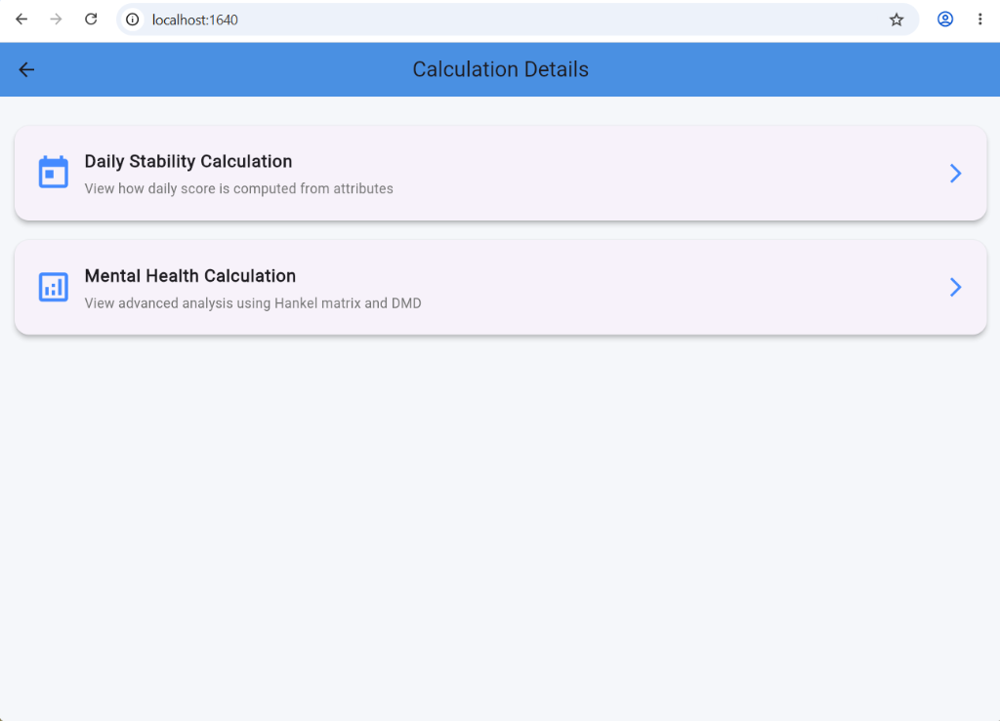
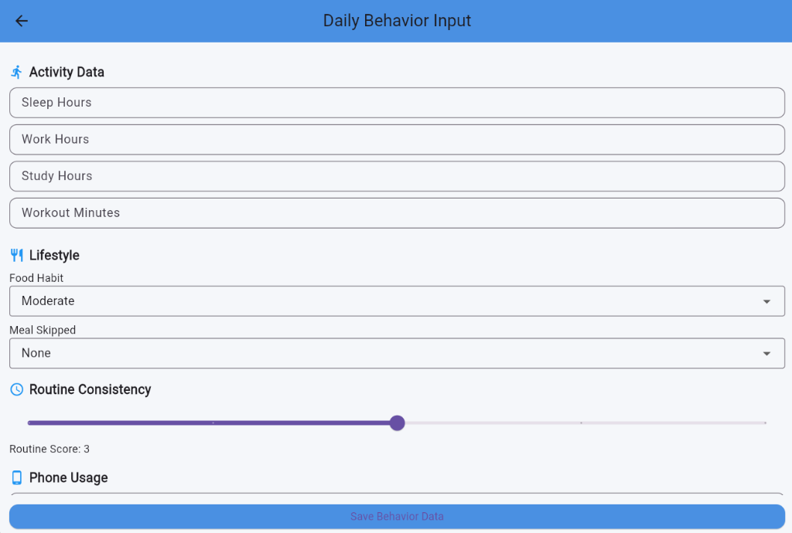

# MindMatrix (Behavioral Monitor) 🧠📊

[](https://flutter.dev)
[](https://dart.dev)
[](https://akashnarayanan007.github.io/behavioral-monitor/)
[](https://flutter.dev)
[]()
[](LICENSE)

**MindMatrix** is an AI-powered behavioral wellness and mental health tracking platform built with Flutter. By combining continuous multidimensional behavioral metrics (sleep hygiene, screen time, routine consistency, social engagement, and physical activity) with dynamical systems modeling (**Hankel Matrices** and **Dynamic Mode Decomposition - DMD**), MindMatrix detects early behavioral shifts, models mental stability, and provides safe, empathetic, and confidential support.

---

## 📸 Application Screenshots

| Calculation Details & Mathematical Modeling | Daily Behavior Input Interface |
| :---: | :---: |
|  |  |
| **Mathematical Engine**<br/>Options for Daily Score calculation & Hankel Matrix / DMD analysis. | **Comprehensive Data Input**<br/>Activity tracking, lifestyle factors, circadian routine & screen usage. |

---

## ✨ Key Features

### 1. 🔬 Mathematical Behavioral Modeling (DMD & Hankel Matrices)
- **Dynamical Systems Modeling**: Employs Hankel time-delay embedding matrices and Dynamic Mode Decomposition (DMD) to extract dominant temporal modes and predict behavioral trajectories.
- **Continuous Multi-factor Scoring**: Replaces arbitrary step functions with Gaussian-decay and continuous penalty curves across 8 key behavioral dimensions:
  - **Sleep Hygiene** (Gaussian optimal window 7–9 hrs with continuous overslept/underslept decay).
  - **Productivity & Focus** (Work & study hours balance).
  - **Physical Activity** (Daily workouts).
  - **Digital Exposure** (Screen time penalization curves).
  - **Nutritional Habits & Regularity** (Meal consistency tracking).
  - **Social Interactions** (Communication frequency and calls).
  - **Circadian Routine Stability**.

### 2. 🛡️ Deterministic Crisis Detection & Escalation
- Real-time linguistic analysis detecting crisis keywords and acute distress signals.
- Guarantees immediate escalation and directs users to verified support resources (helpline, emergency services) while blocking unsafe automated responses.

### 3. 💬 AI Wellness Companion & Session Summaries
- Context-aware emotional support powered by LLMs (Groq / Gemini APIs).
- Provides personalized guidance, cognitive reframing, and structured session summaries that can be reviewed or deleted at any time.

### 4. 🔒 Local-First, Zero-Knowledge Privacy Architecture
- **100% On-Device Persistence**: Built on local SQLite storage (`DatabaseService`).
- **No Private Data Uploads**: Behavioral logs, screen time stats, and chats stay on the device.
- Full user data control including factory reset and immediate record deletion.

---

## 🏗️ Architecture & Core Modules

```
lib/
├── main.dart                          # App initialization, routing & theme setup
├── analysis/                          # Mathematical & algorithmic core
│   ├── daily_score.dart               # Multi-factor continuous scoring algorithm
│   ├── consistency_analysis.dart      # Day-to-day stability variances
│   ├── dmd_analysis.dart              # Dynamic Mode Decomposition engine
│   ├── hankel_matrix.dart             # Time-delay Hankel matrix embedding
│   ├── matrix.dart                    # Linear algebra matrix operations
│   └── mental_state_service.dart      # Stress, Anxiety, and Depression indicators
├── database/
│   ├── database_service.dart          # SQLite CRUD, transactions, factory reset
│   └── resource_database.dart         # Local directory of professional health resources
├── screens/
│   ├── consent_screen.dart            # First-run privacy & explicit consent flow
│   ├── home_screen.dart               # Primary dashboard & feature navigation
│   ├── dashboard_screen.dart          # Longitudinal stability graphs & metrics
│   ├── chat_screen.dart               # Supportive AI conversation interface
│   ├── input_screen.dart              # Manual & automatic daily parameter entry
│   ├── mood_input_screen.dart         # Instant qualitative mood logger
│   ├── daily_stability_screen.dart    # Day-level stability index & AI feedback
│   └── session_summary_screen.dart    # AI post-session summary & rating
└── services/
    ├── crisis_detection.dart          # Deterministic safety rules & escalation
    ├── llm_service.dart               # LLM integration client & safety checks
    ├── notification_service.dart      # Local scheduled wellness reminders
    └── screen_time_service.dart       # Android native usage statistics bridge
```

---

## 🚀 Getting Started

### Prerequisites
- **Flutter SDK**: `>= 3.22.0` (Recommended: `3.47.x`)
- **Dart SDK**: `>= 3.4.0` (Recommended: `3.13.x`)
- **Android SDK**: `API 34+` (Target: `API 35` or `36`)
- **Java Development Kit (JDK)**: `JDK 17`

### Installation

1. **Clone the repository:**
   ```bash
   git clone https://github.com/akashnarayanan007/behavioral-monitor.git
   cd behavioral_monitor
   ```

2. **Install Flutter packages:**
   ```bash
   flutter pub get
   ```

3. **Verify environment health:**
   ```bash
   flutter doctor
   ```

---

## 💻 Running the Application

### 📱 Android (Emulator / Physical Device)
```bash
# 1. Start an Android emulator (e.g. Pixel 6)
flutter emulators --launch Pixel_6

# 2. Run the app
flutter run
```

### 🖥️ Windows Desktop
```bash
flutter run -d windows
```

### 🌐 Web (Google Chrome)
```bash
flutter run -d chrome
```

---

## 🧪 Testing & Code Quality

MindMatrix maintains high code quality standards and automated unit & widget tests:

```bash
# Run static analysis
flutter analyze

# Run unit and widget test suite
flutter test

# Build debug APK for verification
flutter build apk --debug
```

---

## 📦 Key Dependencies

| Dependency | Purpose |
| :--- | :--- |
| `fl_chart` | Interactive linear charts and behavioral trend visualization |
| `sqflite` | Local-first, ACID-compliant on-device SQL database |
| `ml_linalg` | High-performance vector and matrix calculations for DMD |
| `flutter_local_notifications` | Timed, gentle wellness check-in notifications |
| `android_intent_plus` | Android system intent dispatch for permissions |
| `usage_stats` | Android device usage statistics integration |
| `shared_preferences` | Lightweight app configuration and consent state management |

---

## ⚖️ Ethical Considerations & Medical Disclaimer

> [!IMPORTANT]
> **MindMatrix is an experimental wellness tracking and behavioral analytics tool, not a diagnostic medical device.**  
> It does not diagnose, treat, cure, or prevent any mental health conditions. If you or someone you know is experiencing acute emotional distress or a mental health crisis, please reach out to professional emergency services or a national suicide prevention lifeline immediately.

---

## 📄 License

This project is licensed under the [MIT License](LICENSE).
